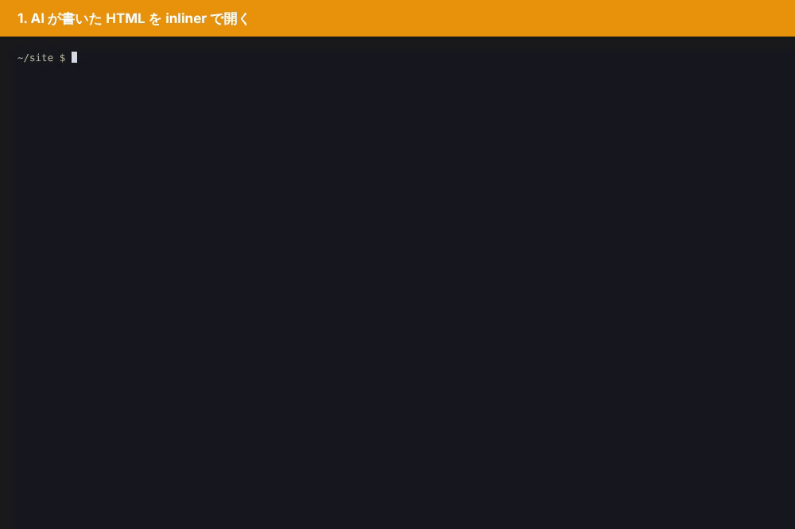

# inliner

AI に書かせたローカルの HTML をブラウザで開き、**気になる箇所に直接コメントを付けて、そのまま AI に渡す**ためのツールです。ちょっとした文言なら、その場で自分で書き換えることもできます。

「3 つ目のカードの見出しが…」と場所を文章で説明する代わりに、テキストを選択してコメントを書くだけ。コメントは `ファイル:行番号` と引用付きの Markdown になるので、AI はどこをどう直せばいいかを取り違えません。



```
AI が HTML を書く → inliner で開いてコメント → AI が .inliner/feedback.md を読んで修正
        ↑                                                      │
        └──────── ページが自動リロードされ、コメントは追従 ────────┘
```

## インストール

Go 1.22 以上で入ります。単一バイナリで、実行時に必要なものはありません。

```sh
go install github.com/ntk221/inliner@latest
```

`inliner` が見つからない場合は `$(go env GOPATH)/bin` を `PATH` に追加してください。インストールせずに試すなら `go run github.com/ntk221/inliner@latest page.html`。

## 使い方

AI が作業しているディレクトリ(プロジェクトのルート)で実行します。

```sh
inliner out/report.html     # ファイルを開く
inliner                     # カレントディレクトリの HTML 一覧から選ぶ
```

ブラウザが開くので、コメントを付けます。

| やりたいこと | 操作 |
| --- | --- |
| 文章にコメント | テキストを選択 →「コメント」 |
| 文言をその場で書き換える | テキストを選択 →「編集」 |
| 画像・ボタン・ブロックにコメント | パネルの「要素を選択」→ 対象をクリック |
| ページ全体へのコメント | パネルの「ページ全体」 |
| 保存 | `⌘/Ctrl + Enter` |

コメントは `.inliner/` に保存され、HTML ファイルには触れません。ファイルが変わるのは、次の「編集」で自分が書き換えたときだけです。

### その場で書き換える

誤字や言い回しのように、AI に頼むまでもない修正は自分で直せます。テキストを選択して「編集」を押し、書き換えて保存すると、**HTML ファイルの該当箇所がそのまま書き換わり**、ページがリロードされます。

- 書き換えるのは選択した文字だけです。前後のタグやインデントは変わりません。入力した `<` や `&` は文字として保存されます。
- ファイル上の位置を一意に特定できたときだけ書き換えます。太字などのタグをまたぐ選択や、スクリプトが生成した文字は書き換えられないので、同じ画面から「この文言に書き換えて」という AI 宛てのコメントとして保存されます。
- 自分で書き換えた箇所は `feedback.md` の末尾にも一覧され、AI が元に戻さないよう伝えます(`inliner clear` で一覧を消せます)。
- 取り消し機能はありません。元に戻すときは、もう一度編集するか `git` を使ってください。

### AI に渡す

方法は 2 つあります。

**1. ファイルを読ませる(おすすめ)** — 未解決のコメントは常に `.inliner/feedback.md` に書き出されています。AI にはこう伝えるだけです。

> `.inliner/feedback.md` のコメントを反映して

**2. コピーして貼る** — パネルの「AI用にコピー」で同じ内容がクリップボードに入ります。チャット型の AI に貼り付ける場合はこちら。

`feedback.md` の中身はこうなります。

```md
## out/report.html

### #1 · `out/report.html:17` · text

- Selected text: "driven by new customers"
- In context: "…grew strongly this quarter, [[driven by new customers]]. Summary Revenue…"
- Inside: `<p class="lead">` (selector `body > header > p`)

> 抽象的すぎる。上位 2 社の社名を入れて。
```

AI がファイルを書き換えるとページは自動でリロードされ、コメントは選択したテキストを手がかりに新しい位置へ追従します(行番号も更新されます)。対象のテキスト自体が消えた場合は「該当箇所が見つかりません」と表示されるので、直ったことを確認して解決にしてください。

### AI に解決済みにしてもらう

AI は対応が終わったコメントを自分で解決済みにできます。メモはパネルに表示されます。

```sh
inliner resolve 1 -m "Acme と Globex の社名を追記"
```

`CLAUDE.md` や `AGENTS.md` に次のように書いておくと、毎回説明せずに済みます。

```md
## HTML のレビューコメント

- HTML へのレビューコメントは `.inliner/feedback.md` にある。「コメントを反映して」と言われたらこれを読む。
- 1 件対応するごとに `inliner resolve <id> -m "何を変えたか"` を実行する。
```

## コマンド

```
inliner [path]              HTML ファイルまたはディレクトリをレビュー用に開く(省略時は .)
inliner show [file]         未解決コメントを Markdown で表示(feedback.md と同じ内容)
inliner resolve <id...>     解決済みにする(-m "メモ")
inliner reopen <id...>      未解決に戻す
inliner rm <id...>          削除する
inliner clear               解決済みコメントと直接編集の記録を削除(--all で全コメントも削除)

  -p, --port <n>     ポート(既定 4600。使用中なら次の空きポート)
      --no-open      ブラウザを開かない
  -C, --root <dir>   プロジェクトのルート(.inliner/ の場所。既定はカレントディレクトリ)
      --all          show: 解決済みも表示
      --json         show: JSON で出力
```

## 仕組みと注意点

- **ローカル専用のサーバー**です。`127.0.0.1` だけで待ち受け、`localhost` 宛て以外のリクエストや他サイトからの書き込みは拒否します。`.git` や `.env` などドットで始まるファイルは配信しません。
- サーバーと CLI は Go(標準ライブラリのみ)、コメント UI は素の JavaScript 1 ファイルで、`embed` でバイナリに同梱しています。
- 配信時に、各タグへソース上の位置(`data-inliner-line` と `data-inliner-at` 属性)を付け、コメント UI のスクリプトを 1 つ挿入します。これはブラウザに送る内容だけの変更で、ディスク上のファイルには入りません。UI は Shadow DOM の中に描画するので、ページのスタイルとは干渉しません。
- 行番号は「選択箇所を含む要素の開始タグの行」です。スクリプトで動的に生成された要素は、ソース上にある直近の親要素の行になります。
- `.inliner/` には自動で `.gitignore` が作られ、コミット対象になりません。
- 対応ブラウザは Chrome / Edge / Safari 17.2 以降 / Firefox 140 以降(テキストのハイライトに CSS Custom Highlight API を使用)。

## 開発

```sh
go test ./...        # ユニットテスト
node e2e/run.mjs     # 実ブラウザでの通しテスト(Node.js と Playwright が必要。無ければスキップ)
node docs/demo/record.mjs   # 上のデモ GIF を撮り直す(ffmpeg も必要)
go build -o inliner . && ./inliner page.html
```

| 場所 | 内容 |
| --- | --- |
| `main.go`, `internal/cli` | コマンドライン |
| `internal/server` | ローカルサーバー、API、変更検知。`client.js` がブラウザ側のコメント UI |
| `internal/annotate` | HTML への行番号付与とスクリプト挿入 |
| `internal/store` | コメントの保存と `feedback.md` の生成 |
